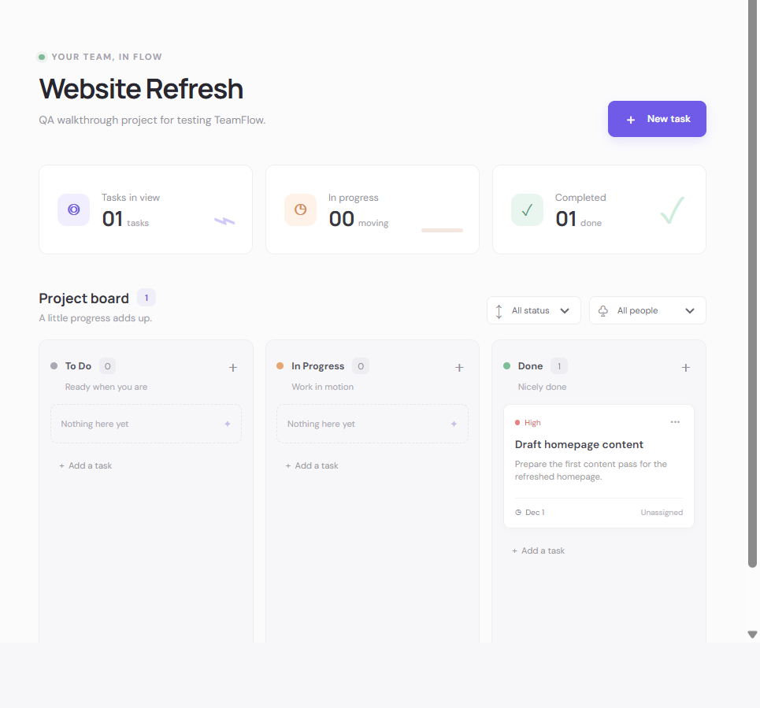

<div align="center">

# TeamFlow

### A calmer way for small teams to organize work and keep projects moving.

[](https://react.dev/)
[](https://vite.dev/)
[](https://nodejs.org/)
[](https://expressjs.com/)
[](https://www.mongodb.com/)

[Features](#features) · [Screenshots](#screenshots) · [Getting started](#getting-started) · [Security](#security) · [Author](#author)

</div>

TeamFlow is a full-stack team task manager built with React, Express, and MongoDB. Create a workspace, organize projects on a Kanban board, and keep tasks, priorities, deadlines, and assignments together in one place.

## Table of contents

- [Features](#features)
- [Screenshots](#screenshots)
- [Technology stack](#technology-stack)
- [Project structure](#project-structure)
- [Requirements](#requirements)
- [Getting started](#getting-started)
- [Run the application](#run-the-application)
- [Tests and build](#tests-and-build)
- [Security](#security)
- [Future improvements](#future-improvements)
- [Author](#author)

## Features

- Account registration, sign-in, and sign-out.
- Multiple workspaces, with the creator as the workspace owner.
- Create projects within workspaces.
- Create, edit, assign, and delete tasks.
- Kanban workflow with **To Do**, **In Progress**, and **Done** statuses.
- Task priorities, due dates, and filters for status and assignee.
- Workspace owners can add or remove existing TeamFlow accounts. Removing a member unassigns their tasks in that workspace.
- Light and dark themes, with the theme preference saved in the browser.
- Workspace, project, member, and task data refresh automatically every 15 seconds while the app is open. Returning to the browser tab also triggers a refresh.

Email delivery, invitation links, password reset, and workspace ownership transfer are not included in the current MVP. A member must have a TeamFlow account before an owner can add them to a workspace.

## Screenshots

The following screenshot is from the running TeamFlow application. It shows the project board and uses demonstration content; account and member details are excluded.



## Technology stack

| Layer | Technologies |
| --- | --- |
| Frontend | React 19, Vite, JavaScript |
| Backend | Node.js, Express 5 |
| Database | MongoDB, Mongoose |
| Authentication | JSON Web Tokens, bcryptjs, HTTP-only cookies |
| Request validation | Zod |

## Project structure

```text
TeamFlow/
├── client/
│   ├── public/                 # Static frontend assets
│   ├── src/
│   │   ├── assets/
│   │   ├── App.jsx
│   │   ├── App.css
│   │   └── index.css
│   ├── index.html
│   ├── package.json
│   └── vite.config.js
├── docs/
│   └── screenshots/
│       └── teamflow-board.png
├── server/
│   ├── src/
│   │   ├── config/             # Database connection
│   │   ├── middleware/         # Authentication and access checks
│   │   ├── models/             # Mongoose models
│   │   └── routes/             # API routes
│   ├── .env.example
│   └── package.json
├── package.json                # Root development and validation scripts
└── README.md
```

## Requirements

- Node.js **20.19+** or **22.12+**
- MongoDB, running locally or available through a hosted service
- npm (included with Node.js)

## Getting started

### 1. Clone the repository

```sh
git clone https://github.com/PatilAdhiraj/TeamFlow.git
cd TeamFlow
```

### 2. Install dependencies

```sh
cd client
npm install
cd ../server
npm install
cd ..
```

### 3. Configure the API

Create `server/.env` from the example. If `server/.env` already exists, keep it and do not overwrite your local settings.

PowerShell:

```powershell
Copy-Item -Path server\.env.example -Destination server\.env
```

macOS/Linux:

```sh
cp server/.env.example server/.env
```

Set the following variables in `server/.env`:

| Variable | Description |
| --- | --- |
| `PORT` | API port. Defaults to `4000`. |
| `MONGODB_URI` | MongoDB connection string. |
| `JWT_SECRET` | Random signing secret of at least 32 characters. |
| `CLIENT_ORIGIN` | Exact frontend origin, such as `http://localhost:5173`. |
| `NODE_ENV` | Use `development` locally and `production` when deployed. |

The example file uses a local MongoDB address and a placeholder JWT value. Replace the placeholder with a strong, randomly generated secret before starting the API.

The frontend defaults to `http://localhost:4000/api`. If your API is hosted elsewhere, create `client/.env` and set `VITE_API_URL` to the API base URL, including `/api`, for example `https://api.example.com/api`. Variables prefixed with `VITE_` are bundled into frontend code and are visible to users; never put secrets in frontend environment variables.

Keep real environment files and credentials out of Git. The repository `.gitignore` excludes `.env` files while allowing the placeholder `server/.env.example`.

## Run the application

Start the API and frontend in separate terminals from the project root.

**Terminal 1 — API**

```sh
cd server
npm run dev
```

**Terminal 2 — frontend**

```sh
cd client
npm run dev
```

Open [http://localhost:5173](http://localhost:5173). By default, the API listens at `http://localhost:4000`.

## Tests and build

Run these commands from the project root:

```sh
npm run test:api
npm run lint
npm run build
```

`npm run test:api` runs the API tests, `npm run lint` checks the frontend, and `npm run build` creates the production frontend bundle.

## Security

- Passwords are hashed with bcrypt.
- Authentication tokens are signed JWTs stored in HTTP-only, same-site cookies; cookies are marked Secure in production.
- Credentialed CORS requests are restricted to the configured `CLIENT_ORIGIN`.
- Mutating requests are checked against the configured frontend origin.
- Project and task routes verify workspace membership before granting access.
- Use a strong random `JWT_SECRET` and a secured MongoDB connection in production.
- Never commit real `.env` files, credentials, or tokens. The `.gitignore` keeps environment files out while retaining `.env.example`.

For production, deploy over HTTPS, set `NODE_ENV=production`, configure `CLIENT_ORIGIN` to the exact frontend origin, and use an appropriately secured MongoDB connection. Set `VITE_API_URL` when the API is not available at the frontend's default address.

## Future improvements

Potential areas to build on include:

- Email-based invitations and password reset.
- Workspace ownership transfer.
- Real-time collaboration instead of periodic refresh.
- Additional project and workspace administration tools.

## Author

[PatilAdhiraj](https://github.com/PatilAdhiraj)
